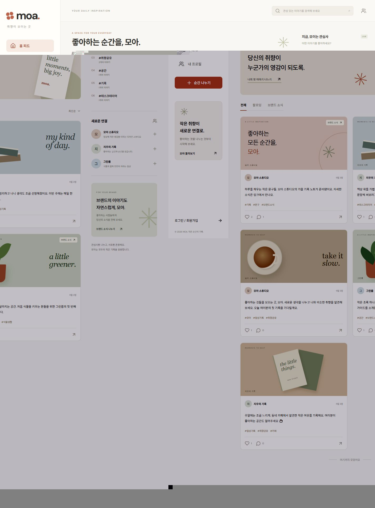

# 모아 MOA

관심사 기반 콘텐츠를 나누고 브랜드 소식을 홍보하는 **개인 프로젝트 SNS**입니다. Spring Boot REST API와 React 화면을 분리했고, 앞서 작성한 MOA 설계안의 회원·게시물·소통·홍보·관리 기능을 구현했습니다.



## 과제 제출 안내

- 저장소 URL: **https://github.com/WonJiSun0730/projectmoa**
- [과제 항목별 설명과 실제 화면·코드 캡처](docs/assignment-report.md)
- [API 목록과 데이터 구조](docs/api-and-data.md)
- [개인 버전 관리 및 검증 기록](docs/development-log.md)
- 기존 MVC 프로젝트는 전달받지 않았으므로 `docs/mvc-before`는 **비교용 예제**입니다. 과거 소스나 실제 팀 협업 이력으로 제시하지 않습니다.

## 실행

Java 21 이상, Node.js 22.12 이상이 필요합니다. Maven은 래퍼가 내려받습니다. 기본 DB는 별도 설치 없이 사용하는 **H2 파일 DB**입니다.

터미널 1 (백엔드):

```powershell
cd backend
.\mvnw.cmd spring-boot:run
```

macOS/Linux에서는 `chmod +x mvnw` 후 `./mvnw spring-boot:run`을 실행합니다.

터미널 2 (프론트엔드):

```powershell
cd frontend
npm ci
npm run dev
```

브라우저에서 **http://127.0.0.1:5173**을 엽니다. Vite가 `/api` 요청을 `127.0.0.1:8080`으로 전달합니다. 상대 경로와 세션 쿠키를 사용하므로 두 화면을 서로 다른 호스트 이름으로 혼용하지 마세요.

## 데모 계정

기본값으로 빈 DB에만 예시 회원·게시물·반응이 생성됩니다.

| 역할 | 이메일 | 비밀번호 |
| --- | --- | --- |
| 회원 / 브랜드 작성자 | hello@moa.test | MoaDemo123! |
| 일반 회원 | jiwoo@moa.test | MoaDemo123! |
| 브랜드 회원 | green@moa.test | MoaDemo123! |
| 관리자 | admin@moa.test | MoaAdmin123! |

예시 홍보 링크는 `example.com`입니다. 실제 상품 구매·결제 기능은 없습니다. 공개 운영 시에는 새 DB에 `MOA_DEMO_DATA=false`, HTTPS 환경에서 `COOKIE_SECURE=true`를 설정하세요. 이미 생성된 예시 데이터는 설정을 바꿔도 자동 삭제하지 않습니다.

## 구현 기능

- 이메일 회원가입, BCrypt 비밀번호, 세션 로그인·로그아웃, CSRF 검증
- 프로필 조회·수정, 팔로우·취소, 팔로잉 피드
- 전체·브랜드 피드, 본문·닉네임·해시태그 검색, 커서 페이지 이동
- 게시물 작성·수정·논리 삭제, JPG/PNG 이미지 최대 4장, 파일당 5MB
- 좋아요·취소, 댓글 등록·수정·삭제, 작성자 권한 검사
- 홍보 게시물 표시, 외부 링크, 본인 게시물별 좋아요·댓글 집계
- 게시물 신고, 관리자 숨김·기각, 회원 이용 제한·복구
- 모바일 대응, 이미지 미리보기, 로딩·오류·빈 목록 처리, 키보드 모달 이동

사진이 없는 글은 CSS 장식 배경을 사용합니다. 기본 피드의 그림은 실제 첨부 사진으로 가장하지 않습니다. 업로드한 이미지는 해당 장식 대신 실제 파일을 표시합니다.

## 빌드와 테스트

```powershell
cd backend
.\mvnw.cmd verify
```

```powershell
cd frontend
npm run build
```

`backend/target/moa-1.0.0.jar`와 `frontend/dist/`를 생성합니다. 프론트는 `/api`를 백엔드로 전달하는 같은 출처의 웹 서버 뒤에 배포합니다. `npm run preview`는 정적 프론트 확인용이며 API 프록시는 개발 서버에만 설정되어 있습니다.

HTTP 통합 테스트는 별도의 메모리 DB를 사용합니다. 인증·CSRF·작성자 권한·멱등 좋아요·팔로우·댓글·검색·페이지 이동·숨김·파일 검증 등을 확인합니다. GitHub Actions에서도 API 검증과 프론트 빌드를 수행합니다.

## 프로젝트 구조

```text
backend/
  src/main/java/com/moa/api/        REST 컨트롤러와 오류 응답
  src/main/java/com/moa/service/    권한·트랜잭션·파일 검증
  src/main/java/com/moa/config/     세션 보안과 예시 데이터
  src/main/resources/schema.sql    9개 테이블과 제약조건
  src/test/java/com/moa/           실제 HTTP 요청 통합 테스트
frontend/
  src/main.jsx                    화면과 사용자 흐름
  src/api.js                      JSON·파일 전송과 CSRF
  src/styles.css                  반응형 스타일
docs/                             제출 설명과 캡처
```

## 저장 위치와 범위

DB와 업로드 파일은 백엔드 실행 폴더 아래 `.data/`에 저장되고 Git에서 제외합니다. 외부 DB 연결은 `MOA_DB_URL`, `MOA_DB_USERNAME`, `MOA_DB_PASSWORD`를 사용합니다. 기본 초기화 SQL은 H2 MySQL 모드용이므로 실제 MySQL 배포에는 해당 버전에 맞는 스키마 마이그레이션이 필요합니다.

실시간 채팅·동영상·결제·광고비·노출/클릭 추적·비공개 계정은 포함하지 않습니다. 가입 이메일 인증, 비밀번호 재설정, 로그인 시도 제한과 대규모 피드 조회 최적화는 후속 개선 범위입니다. 설계 보고서의 응답 시간 목표는 아직 부하 시험으로 검증하지 않았습니다.
