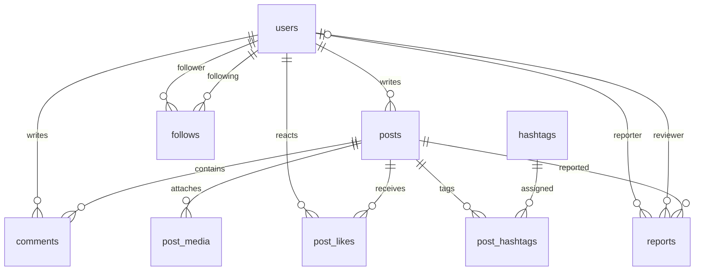

# API와 데이터 구조

모든 응답은 JSON이며 이미지 응답만 바이너리입니다. 경로는 `/api` 기준입니다. 세션 쿠키는 HttpOnly, SameSite=Lax입니다. 변경 요청은 `/auth/csrf`에서 받은 `headerName`과 `token`을 헤더에 넣습니다. Spring Security가 CSRF를 검증하고 서비스가 회원 상태·작성자·관리자 권한을 확인합니다.

| 메서드 | 경로 | 설명 |
| --- | --- | --- |
| GET | /auth/csrf | 보안 토큰 |
| POST | /auth/register | 가입, 201 |
| POST | /auth/login | 로그인·세션 ID 변경 |
| POST | /auth/logout | 세션 무효화, 204 |
| GET | /auth/me | 로그인 회원 정보 |
| GET | /posts?tab=all&q=&userId=&before= | 피드·검색, 20개 + nextCursor |
| POST | /posts | 게시물 생성, 201 + Location |
| GET / PUT / DELETE | /posts/{id} | 조회·수정·논리 삭제 |
| PUT / DELETE | /posts/{id}/like | 원하는 좋아요 상태, 멱등 요청 |
| GET / POST | /posts/{id}/comments | 댓글 목록·등록 |
| PUT / DELETE | /posts/{id}/comments/{commentId} | 본인 댓글 수정·삭제 |
| POST | /posts/{id}/media | multipart의 files 필드에 이미지 첨부 |
| GET / DELETE | /posts/{id}/media/{mediaId} | 이미지 조회·삭제 |
| GET | /users/{id} | 공개 프로필, 이메일·권한 제외 |
| PATCH | /users/me | 본인 프로필 변경 |
| PUT / DELETE | /users/{id}/follow | 팔로우·취소, 자기 팔로우 금지 |
| GET | /discover | 공개 태그 빈도·발견할 회원 |
| GET | /insights | 현재 로그인 회원의 공개 게시물 반응 |
| POST | /posts/{id}/reports | 신고 접수, 201 |
| GET | /admin/reports | 관리자 신고 목록 |
| PATCH | /admin/reports/{id} | 숨김 또는 기각과 처리 사유 |
| PATCH | /admin/users/{id} | 이용 제한·복구 |

## 게시물 요청 예시

```json
{
  "content": "새로운 기록 노트를 소개합니다.",
  "postType": "PROMOTION",
  "externalUrl": "https://example.com/notebook",
  "tags": ["문구", "기록"]
}
```

피드는 `all`, `following`, `promotion`을 지원합니다. `following`은 로그인해야 합니다. 게시물 ID 내림차순으로 정렬하고 다음 요청에 `nextCursor`를 `before`로 전달합니다. 키워드의 `%`, `_`는 와일드카드가 아니라 글자로 검색합니다.

## 응답 규칙

- 200: 조회·변경 결과, 201: 생성, 204: 본문 없는 변경 완료
- 400: 입력값·URL·이미지 형식 오류, 401: 로그인 필요
- 403: 작성자·관리자·회원 상태·CSRF 권한 오류
- 404: 없는 콘텐츠 또는 숨김·삭제 콘텐츠
- 409: 중복 이메일·닉네임·신고 또는 이미 처리된 신고
- 413: 업로드 크기 초과

오류 응답 예: `{ "message": "본문은 1~2,000자로 입력해 주세요." }`

## ERD



테이블의 모든 컬럼·타입·고유키·외래키는 [`schema.sql`](../backend/src/main/resources/schema.sql)에 있습니다. `post_likes`, `follows`, `post_hashtags`는 복합 기본키를 사용하고 게시물별 이미지 순서는 고유합니다. 최대 4장 제한과 파일 검증은 서비스에서도 검사합니다.

태그는 #을 제거하고 영문을 소문자로 정규화한 뒤 중복을 제거합니다. 게시물 저장과 태그 연결은 같은 트랜잭션입니다. 숨김·삭제된 글은 검색·댓글 조회·이미지 직접 URL에서도 404를 반환합니다. 콘텐츠 삭제는 논리 삭제이고 첨부 이미지 개별 삭제는 실제 파일도 정리합니다.

## 설계안 대비 구현 결정

- 설치 편의를 위해 H2 파일 DB를 기본값으로 선택했습니다. 실제 MySQL은 별도 마이그레이션 대상입니다.
- Java 표준 이미지 디코더로 실제 파일 내용을 검증하기 위해 업로드는 JPG/PNG로 한정했습니다. WebP는 후속 확장입니다.
- 별도 브랜드 계정 구분 없이 모든 회원이 홍보 게시물을 작성합니다. 일반 글과 홍보 글은 유형 필드로 구분합니다.
- 반응 관리는 좋아요와 유효 댓글만 집계합니다. 노출·링크 클릭·전환율을 수집한 것처럼 표시하지 않습니다.
