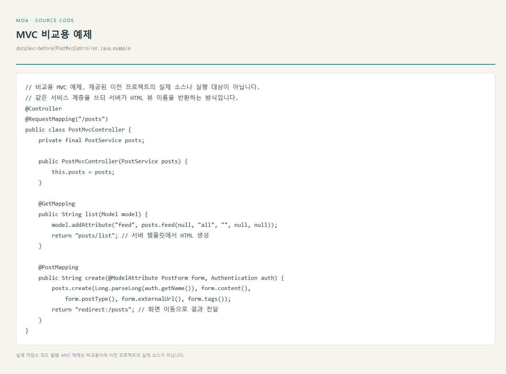
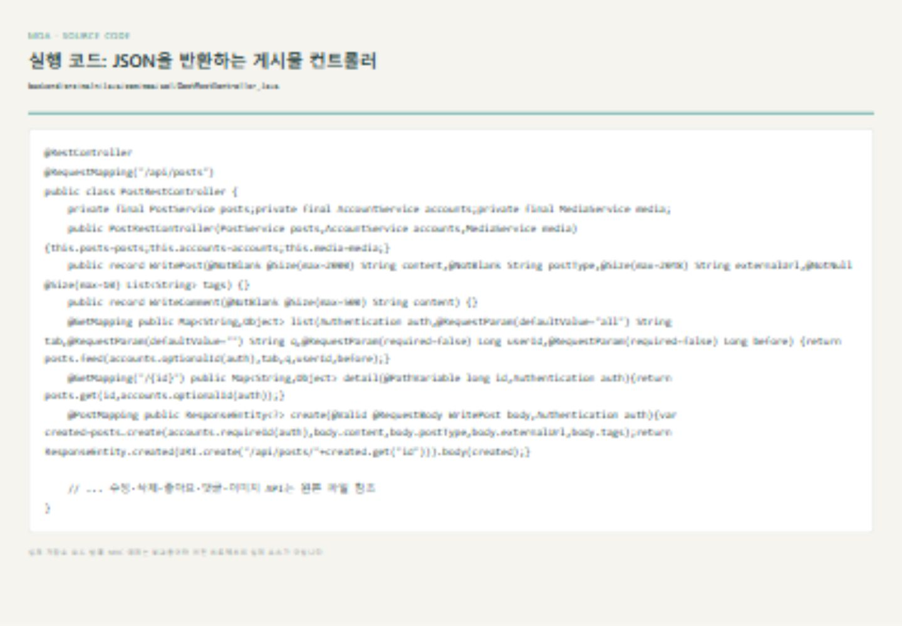
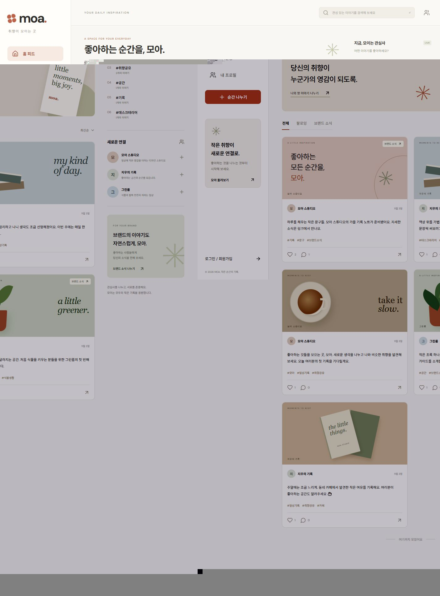
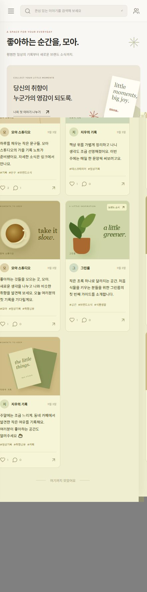
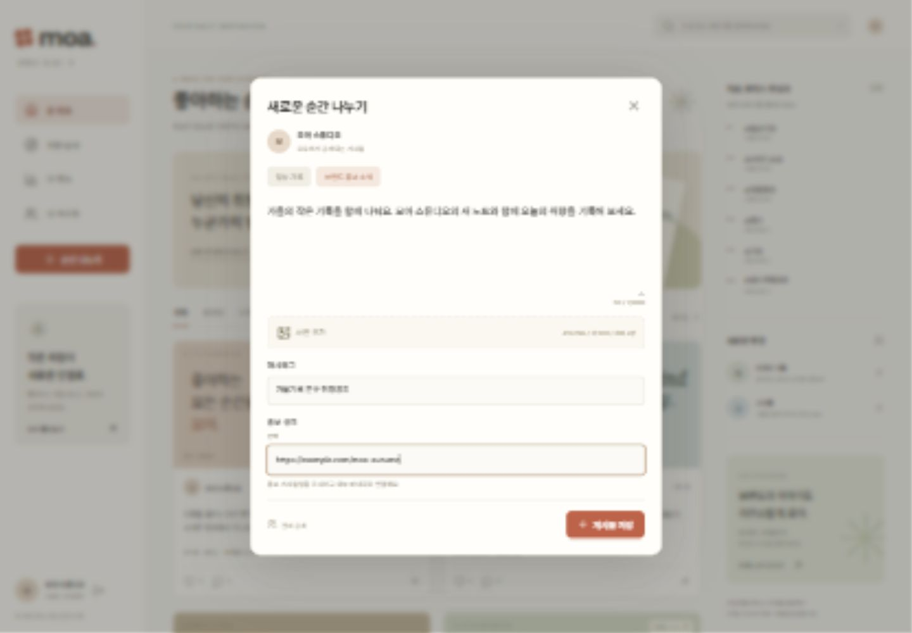
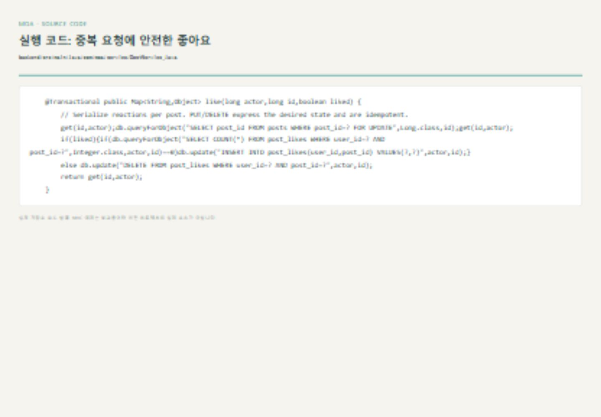
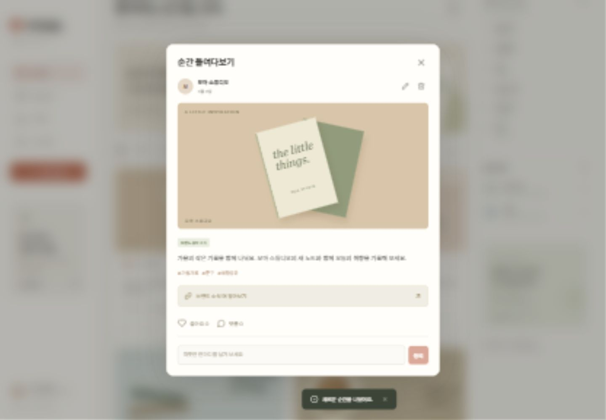
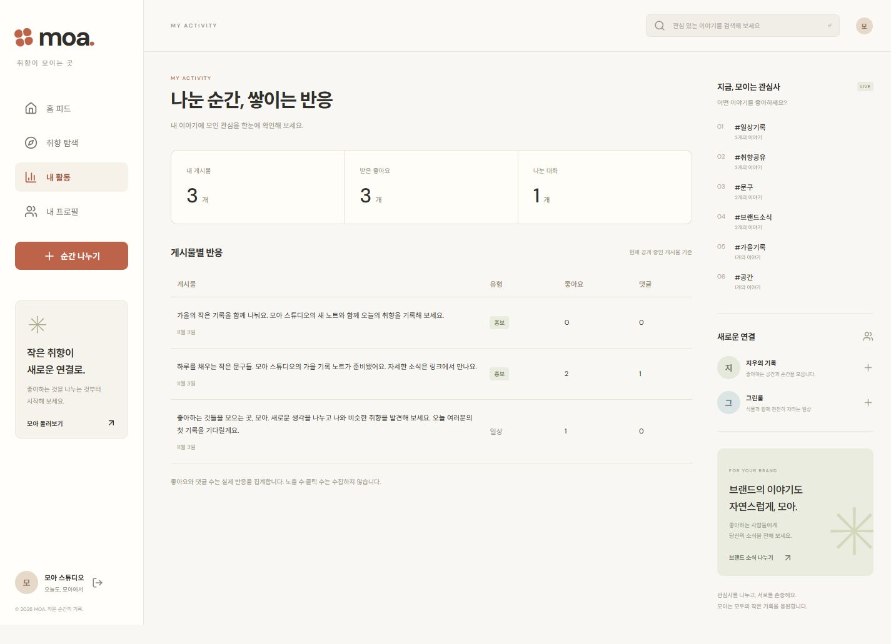
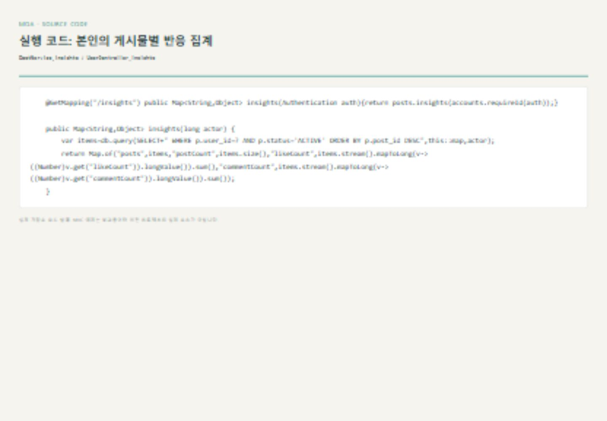

# 프로젝트3 구현 설명서

**주제:** 홍보·마케팅에 활용 가능한 관심사 SNS, 모아(MOA)  
**제출 방식:** 개인 프로젝트 GitHub 저장소  
**저장소:** https://github.com/WonJiSun0730/projectmoa

## 1. Spring Boot 대표 컨트롤러의 REST 전환

대표 대상은 **게시물 컨트롤러**입니다. 기존 MVC 프로젝트 소스를 제공받지 않았기 때문에 전환 전은 같은 기능을 MVC로 작성한 **비교용 예제**입니다. 실제 과거 프로젝트의 코드·Git 이력이라고 주장하지 않습니다. 최종 실행 코드는 `PostRestController`입니다.

| 비교 | MVC 예제 | 최종 REST API |
| --- | --- | --- |
| 클래스 | `@Controller` | `@RestController` |
| 목록 응답 | `Model`에 데이터를 넣고 뷰 이름 반환 | JSON의 `items`, `nextCursor` 반환 |
| 생성 입력 | `@ModelAttribute` 폼 | `@Valid @RequestBody` DTO |
| 생성 결과 | `redirect:/posts` | 201 Created, Location, JSON |
| 화면 담당 | 서버 HTML 템플릿 | React 컴포넌트 |
| 상태 전달 | 페이지 이동 중심 | 400·401·403·404·409 등 HTTP 상태 |

전환 전 비교용 예제: [`PostMvcController.java.example`](mvc-before/PostMvcController.java.example)

최종 실행 코드: [`PostRestController.java`](../backend/src/main/java/com/moa/api/PostRestController.java)

`POST /api/posts`는 사용자가 보낸 `userId`를 신뢰하지 않고 로그인 세션에서 작성자를 정합니다. 입력값을 검증하고 저장 후 생성 리소스 URL을 반환합니다. `GET /api/posts`와 `GET /api/posts/{id}`는 HTML 대신 JSON을 반환합니다. React가 데이터를 받아 화면을 갱신하므로 등록·댓글·좋아요 때 전체 HTML을 다시 받아올 필요가 없습니다.

세션 인증을 선택했으므로 무상태 REST의 모든 제약을 충족한다고 주장하지 않습니다. 이번 구현은 **리소스 URL·HTTP 메서드·상태 코드·JSON 응답을 적용한 REST 스타일 API**입니다.

## 2-1. React UI/UX 개선

이전 실행 화면은 제공받지 않았으므로 실제 이전 화면과의 비교 사진을 꾸미지 않았습니다. 다음은 설계안의 화면 흐름을 구체화해 구현한 개선 사항입니다.

### 화면 1: 홈 피드

- 전체·팔로잉·브랜드 소식 탭으로 목적에 맞는 글을 구분합니다.
- 이미지·작성자·본문·해시태그·반응을 한 카드에서 확인합니다.
- 검색은 본문·닉네임·태그를 대상으로 하며 결과가 없을 때 별도 안내합니다.
- 좋아요는 처리 중 같은 버튼의 중복 클릭을 막고 서버가 반환한 수로 갱신합니다.
- 관심사·회원 발견 영역은 실제 공개 게시물과 회원 데이터를 사용합니다.
- 모바일에서는 오른쪽 보조 영역을 숨기고 메뉴를 접어 본문 공간을 확보합니다.

핵심 화면 코드는 [`main.jsx`](../frontend/src/main.jsx)의 `App`, `PostCard`, `PostArt`입니다. 반응형 스타일은 [`styles.css`](../frontend/src/styles.css)에 있습니다. 사진이 없는 데모 글은 CSS로 만든 장식 배경을 표시합니다.

### 화면 2: 작성 화면

- 일상 기록과 브랜드·홍보 소식을 명시적으로 선택합니다.
- 글자 수를 보여주고 공백 본문의 등록을 막습니다.
- 이미지 파일 형식·용량·장수를 확인하고 미리보기·제거·순서 변경을 제공합니다.
- 홍보 유형에서만 링크 필드를 표시합니다.
- 저장 중 버튼을 비활성화하고 실패 이유를 같은 화면에 보여줍니다.
- 본문 저장 후 이미지 업로드가 실패하면 기존 게시물 ID로 재시도해 글이 중복 생성되지 않도록 합니다. 이 경우 본문은 이미 공개 저장됐음을 안내합니다.
- 모달은 Escape로 닫기, Tab 포커스 순환, 닫은 뒤 이전 포커스 복귀를 지원합니다.

실제 로직: `main.jsx`의 `Compose`, `Modal`, `api.js`의 `api`입니다. 이미지 업로드와 본문 저장은 별도 API이므로 한 번의 원자적 게시 작업은 아닙니다. 이 한계와 재시도 동작을 UI에서 안내합니다.

## 2-2. 핵심 기능 코드 리뷰

### 좋아요의 멱등성과 중복 방지

코드: [`PostService.java`](../backend/src/main/java/com/moa/service/PostService.java)의 `like`

1. `PUT /posts/{id}/like`는 좋아요가 있는 상태를, `DELETE`는 없는 상태를 요청합니다.
2. `@Transactional`과 게시물 행 잠금으로 같은 게시물의 동시 반응 처리를 직렬화합니다.
3. 이미 있는 좋아요는 다시 INSERT하지 않습니다. DB의 `(user_id, post_id)` 복합 기본키가 중복을 추가로 방지합니다.
4. 변경 후 서버가 집계한 `likeCount`, `liked`를 반환합니다. 프론트는 이 응답으로 해당 카드를 교체합니다.
5. 로그인·이용 상태와 게시물 공개 상태를 확인합니다.

현재 방식은 게시물 단위 잠금이므로 인기 글의 높은 동시성에서는 병목이 될 수 있습니다. 대규모 서비스에서는 원자적 upsert와 별도 집계 구조를 검토할 수 있습니다. 이번 개인 프로젝트에서는 중복 방지와 설명 가능한 흐름을 우선했습니다.

### 입력 검증·권한·데이터 저장

- 회원의 비밀번호는 BCrypt 해시로 저장합니다. 세션 쿠키와 CSRF 토큰으로 로그인 상태와 변경 요청을 보호합니다.
- 게시물과 댓글 수정·삭제는 서비스에서 세션의 작성자 ID를 비교합니다. 화면에서 메뉴만 숨기는 방식에 의존하지 않습니다.
- 게시물·태그 연결은 트랜잭션으로 저장하고 태그는 소문자 정규화·중복 제거합니다.
- 이미지 확장자나 브라우저 MIME만 믿지 않고 서버에서 실제 JPG/PNG 디코딩·화소·크기를 검사합니다.
- 숨김·삭제 글은 상세뿐 아니라 댓글 조회와 이미지 URL에서도 노출하지 않습니다.

관련 코드: `AccountService`, `SecurityConfig`, `PostService`, `MediaService`, `ErrorHandler`

## 2-3. 새로 확장한 홍보 기능

이전 프로젝트의 실제 한계가 확인되지 않았으므로 **새로 확장한 기능**으로 제출합니다.

### 홍보 유형과 외부 링크

일반 게시물과 홍보 게시물을 `post_type`으로 구분하고 홍보 글에 표시를 붙입니다. 외부 링크는 `http`·`https`와 유효한 호스트만 허용하고 계정 정보가 포함된 URL은 거부합니다. 브라우저는 `noopener noreferrer`를 적용한 새 창으로 엽니다. 서버가 링크 대상에 접속하거나 외부 데이터를 수집하지는 않습니다.

실제 관련 코드: `PostService.validate`, `PostRestController.WritePost`, React `Compose`·`Detail`

### 작성자 전용 게시물 반응 관리

`GET /api/insights`는 **세션 회원 본인**의 현재 공개 게시물만 조회합니다. 전체 게시물 수·받은 좋아요 수·유효 댓글 수를 보여주고 게시물별 반응을 비교할 수 있습니다. 홍보 게시물의 관심도를 확인하는 기초 자료로 활용할 수 있습니다.

노출 수·클릭 수·구매 전환은 기록하지 않으므로 해당 지표나 마케팅 성과를 추정값으로 꾸미지 않습니다. 단순한 반응 확인 기능이며 실시간 분석 서비스는 아닙니다.

## 검증과 개인 Git 이력

- 실제 HTTP 통합 테스트 14개: 인증, CSRF, 소유권, 좋아요 멱등성, 팔로우, 댓글, 태그 검색, 커서 페이지 이동, 신고·숨김, 업로드 검증, 이미지 접근 통제, 로그아웃 검증
- 브라우저 확인: 데모 로그인, 홍보 게시물 작성·저장, 상세 링크, 댓글 등록, 반응 집계, 오류 로그 확인
- 모바일 360px 화면의 가로 넘침 여부 확인
- 캡처는 로컬에서 실행한 실제 화면입니다. 회원·게시물·반응 수는 설명용 데모 데이터와 테스트 입력입니다.
- 개인 작업이므로 다른 팀원의 이름·기여·리뷰를 만들지 않습니다. 커밋은 구현 범위별로 구분하고 기능 브랜치를 남깁니다.

## 참고한 공식 문서

- [Spring Boot Servlet Web Applications](https://docs.spring.io/spring-boot/reference/web/servlet.html)
- [Spring Security CSRF](https://docs.spring.io/spring-security/reference/servlet/exploits/csrf.html)
- [Vite 시작하기](https://vite.dev/guide/)

모아의 콘텐츠·디자인·데모 통계는 과제용으로 만든 것이며 외부 서비스의 실제 조사 결과가 아닙니다.
